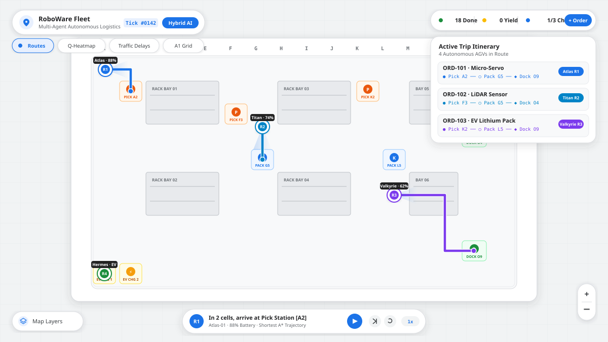
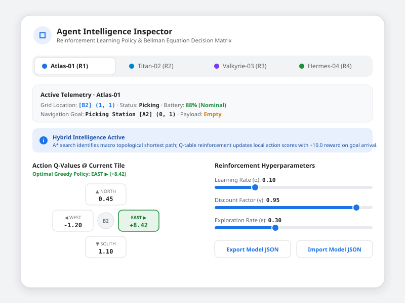

# RoboWare — Autonomous Multi-Agent Warehouse Simulation

> **Spatial Fleet Intelligence & Multi-Agent Reinforcement Learning in a Google Maps-inspired Cartography Interface.**



---

## 🧭 Overview

**RoboWare** is an interactive, browser-based multi-agent warehouse simulation engineered with React 19, TypeScript, Tailwind CSS, and Lucide Icons. Designed with a **Google Maps Cartography & Human AI visual language**, it demonstrates real-time autonomous ground vehicle (AGV) routing combining:

1. **A\* Shortest-Path Search** around physical rack structures and traffic reservations.
2. **Tabular Q-Learning (Bellman Equation)** for adaptive reinforcement policy updates.
3. **Multi-Agent Collision Avoidance** with cooperative right-of-way yielding.
4. **Traffic & Battery Management** with automatic diversion to EV charging docks.
5. **Live Supply Chain Order Demand** covering multi-stop trips (Pick Station → Packing Hub → Outbound Dock).

---

## 📸 Interface Previews

### 1. Main Warehouse Fleet Operations
The primary map canvas operates on a 16×10 coordinate grid (Aisles A1–P10) featuring Google Maps road corridors, building footprint storage racks, live GPS navigation beacons, and turn-by-turn routing polylines:


### 2. Human AI Agent Intelligence Inspector
Inspect real-time Q-scores for directional actions (North, South, East, West), configure reinforcement hyperparameters ($\alpha$, $\gamma$, $\varepsilon$), and export/import learned policies:



---

## ✨ Key Features

- **Google Maps Design System**:
  - Crisp light gray map canvas (`#F1F3F4`) with pure white aisle roadways and subtle lane lines.
  - Storage racks modeled after Google Maps architectural building footprints with bay markings (`BAY A1`, `BAY B2`).
  - Familiar POI markers:
    - 🟧 **Pick Station** (`#EA580C`)
    - 🟦 **Pack Hub** (`#1A73E8`)
    - 🟩 **Outbound Dock** (`#1E8E3E`)
    - 🟨 **EV Charging Bay** (`#F59E0B`)
  - **Google Blue Navigation Pucks** with directional heading light cones, live GPS pulse rings, and hover tooltips.
  - **Google Blue Navigation Routes** with turn indicators, teardrop destination pins, and traffic delay indicators (switching to amber/red during yield states).

- **Multi-Agent Simulation Engine**:
  - **4 Autonomous AGVs**:
    - `R1: Atlas-01` (Google Blue `#1A73E8`)
    - `R2: Titan-02` (Deep Sky `#0284C7`)
    - `R3: Valkyrie-03` (Tactile Purple `#7C3AED`)
    - `R4: Hermes-04` (Google Green `#1E8E3E`)
  - **Collision Prevention**: Predictive time-space reservation prevents intersection deadlocks. Lower-priority agents yield right-of-way with visual traffic alert flags.
  - **Autonomous Battery Lifecycle**: Agents consume power per movement step. When battery drops below 20%, the AGV autonomously diverts to the nearest available EV charging dock to recharge to 96%+.

- **Reinforcement Learning Model**:
  - Full Bellman reinforcement equation:
    $$Q(s, a) \leftarrow Q(s, a) + \alpha \left[ R + \gamma \max_{a'} Q(s', a') - Q(s, a) \right]$$
  - Switchable modes:
    - **Hybrid AI** (A\* macro trajectory + Q-Learning micro reinforcement)
    - **Pure A\*** (Deterministic shortest Manhattan path)
    - **Q-Learning Only** (Epsilon-greedy exploration and learned policy execution)
  - Interactive sliders for Learning Rate ($\alpha$), Discount Factor ($\gamma$), and Exploration Rate ($\varepsilon$).

- **Standard Model JSON Export & Import**:
  Export and import trained policies matching the following schema:
  ```json
  {
    "q_table": [[0.0, 0.0, 0.0, 0.0]],
    "actions": ["up", "down", "left", "right"],
    "goal": [14, 8],
    "step_reward": -1,
    "goal_reward": 10,
    "discount_factor": 0.95
  }
  ```

- **Interactive Map Layers & Floor Customizer**:
  - Paint or reconfigure warehouse tiles in real-time: Storage Racks, Pick Stations, Pack Hubs, Outbound Docks, EV Chargers, or Clear Aisles.
  - Layer toggles for A\* Routes, Q-Value Heatmap, Traffic Delays, and Coordinate Grid.

---

## 🚀 Getting Started

### Prerequisites
- Node.js 18+
- npm or bun

### Installation
```bash
# Clone the repository
git clone https://github.com/your-username/roboware.git
cd roboware

# Install dependencies
npm install

# Start the Vite development server
npm run dev
```

Visit `http://localhost:3000` to interact with the simulation.

---

## 🛠️ Tech Stack

- **Framework**: React 19, TypeScript
- **Styling**: Tailwind CSS, Google Material 3 elevation shadows
- **Icons**: Lucide React
- **Audio**: Web Audio API synthesized navigation chimes
- **Build Tool**: Vite 8

---

## 📄 License
Apache-2.0
